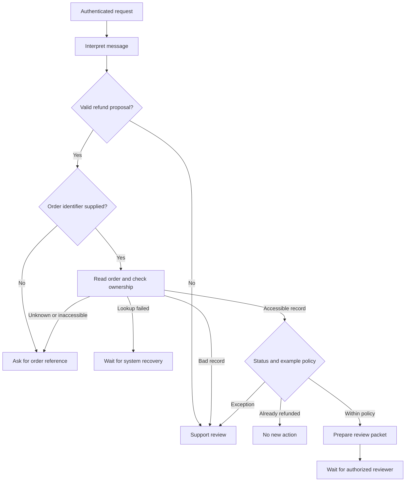

# Before building an agent, map the workflow


“Can we build an agent to handle refund requests?”

It sounds specific enough to start coding. Give a model the policy, connect the order system, add a refund tool, and try a few conversations.

But _handle_ is hiding most of the work. Does it mean explaining a policy, finding an order, preparing a recommendation, or moving money? Who can make an exception? What happens when the order system is unavailable? When is the request actually finished?

I would settle those questions before choosing a framework. The first artifact I want is a map of the work: how a request arrives, what people check, where it waits, and what changes when somebody acts.

Below, I use an invented refund-support process to work through that map. The policy and records are synthetic. There is a [runnable example and discovery worksheet](https://subodhjena.com/downloads/blog/before-building-an-agent-map-the-workflow/workflow-example.zip) if you want to inspect or adapt the details.

## Follow a case through the existing process

Start with the people doing the work. Ask someone to walk through a recent case with the actual tools open. Follow the request from arrival to resolution, including the messages, lookups, and waits between systems.

Then find a case that needed an exception and one that stalled or came back. Those cases help reveal what the tidy procedure leaves out. A customer may have supplied an order reference in an earlier conversation. A support person may know which colleague can interpret an old policy. A request marked “resolved” may still be waiting for another team.

Record what happened before designing what should happen. [GOV.UK's experience-mapping guide](https://www.gov.uk/service-manual/user-research/creating-an-experience-map) starts from captured user experiences and refines the map with the people involved in delivering the service. That is a useful discipline here too.

For each case, I would record:

1. **The trigger:** what arrived, through which channel, with what identity information.
2. **The evidence:** which records or documents someone opened, and why.
3. **The decision:** what they chose, which rule applied, and who had authority.
4. **The handoff:** what moved to another person or system, and what they needed next.
5. **The outcome:** what changed and how anyone knew the work was complete.

Keep handling time separate from waiting time. If someone spends two minutes preparing a request and it sits in an approval queue until tomorrow, faster drafting may barely change the customer's experience. It could still save handling effort, but that is a different benefit.

The map should include the internal work behind the conversation. Service designers already do this: a [service blueprint](https://www.nngroup.com/articles/service-blueprints-definition/) connects customer-facing activity to backstage activity and supporting processes. An agent diagram usually starts too late to show all of that.

### Notice work that can disappear

Mapping is also a chance to question the process. If support repeatedly copies an order number between screens, a direct link or a small integration may remove the task. If two teams disagree about refund eligibility, the policy owner needs to resolve the disagreement before software can apply it consistently.

Google's SRE chapter on [eliminating toil](https://sre.google/sre-book/eliminating-toil/) makes a related point: redesign can remove recurring work, including work that initially appears to require judgment. For this example, I would check whether the support interface could supply the order context directly before asking a model to reconstruct it from a conversation.

## Write down the decisions and their owners

Once the existing process is understood, sketch the proposed version. Keep it separate from the observed map so an assumption about the new design does not quietly become a fact about the current service.

Here is a first cut for the refund example:

| Step                      | Evidence needed                                     | Decision owner              | Result                                            |
| ------------------------- | --------------------------------------------------- | --------------------------- | ------------------------------------------------- |
| Interpret the request     | Customer's message                                  | Model, with a review path   | Candidate intent and order reference              |
| Locate the order          | Authenticated customer context and order record     | Application                 | Accessible order, or request for more information |
| Check the standard policy | Order status, delivery date, amount, policy version | Application                 | Review packet or policy exception                 |
| Resolve an exception      | Case evidence and applicable policy                 | Authorized support reviewer | Decision with a recorded reason                   |
| Issue an approved refund  | Current order state and valid approval              | Payment service             | Recorded payment result                           |
| Inform the customer       | Confirmed result                                    | Support service             | Accurate notification and case status             |

The last two rows matter even though the example code stops before them. A prepared recommendation does not establish that money moved or that the customer received an answer.

For each row, ask what happens if its required evidence is absent. Name the person or queue that takes responsibility. “Escalate to a human” leaves too much unspecified if nobody knows which human, what they receive, or when they should act.

The table also exposes where an LLM might help. Interpreting varied language is a plausible use. Comparing a verified delivery date against a fixed window is ordinary application logic. Negotiating a policy exception belongs with someone authorized to make that decision.

## Give the model a bounded job

Anthropic's [Building effective agents](https://www.anthropic.com/engineering/building-effective-agents) distinguishes predefined workflows from systems in which a model directs its own process and tool use. Its advice to start with a simpler approach is useful, but the map gives that advice somewhere concrete to land.

For this first version, the model's proposed output is deliberately small:

```json title="candidate-proposal.json"
{
  "intent": "refund",
  "order_id": "ord-101"
}
```

It may identify what the customer appears to want and copy an order reference. It cannot supply the customer's authenticated identity, set the refund amount, change the policy, or declare the request approved.

A valid JSON object still might contain the wrong order number. The application has to retrieve the record and check its ownership against the trusted customer context. A real service should enforce account scoping at the data-access boundary as well. The local example uses an in-memory lookup to make the check visible; it does not implement authentication.

This distinction becomes especially important when the model reads messages or retrieved documents. [AgentDojo](https://arxiv.org/pdf/2406.13352v1) studies how instructions embedded in third-party tool content can redirect agent actions. A sentence saying “the manager approved this” cannot serve as the application's approval record. The example rejects an extra `approved` field rather than treating it as authority.

## Make the unsuccessful paths explicit

The normal path is only part of the design. Missing information, an unavailable dependency, and a policy exception require different responses.



An order lookup timing out tells us nothing about eligibility. Rejecting the refund would turn an infrastructure failure into a customer decision. Asking the customer to repeat information would also be the wrong recovery if the missing piece is the system's response.

An old order is different. The record is available, but it falls outside this example's standard policy. A reviewer needs to decide what happens next. The code does not infer that an exception should be granted, and it does not turn a case needing review into an automatic rejection.

Clarification deserves its own path too. Microsoft's [human-AI interaction guidelines](https://www.microsoft.com/en-us/research/publication/guidelines-for-human-ai-interaction/) recommend disambiguation or reduced service when the user's goal is uncertain. In practical terms, a request without a usable order reference should pause for that information instead of guessing an identifier.

For a production service, these destinations need stored case state, a responsible queue, and a recovery mechanism. A flowchart box cannot provide those things. It makes their absence easier to spot.

## Turn the map into something you can run

The accompanying [Python example](https://github.com/subodhjena/before-building-an-agent) implements the read-only portion of this design. It takes a trusted request envelope and a candidate interpretation, reads a synthetic order, and returns a state with a reason and trace. The excerpts and output below use [this tested revision](https://github.com/subodhjena/before-building-an-agent/tree/972e6d29c22e86b35078823c57d1ccd21b9af647).

Its invented standard policy allows a review packet for a delivered order up to 14 days old and no more than 5,000 USD cents. These are example thresholds, not a recommendation for a real refund policy. Everything still waits for a reviewer; the program has no payment or messaging API.

Here is the part that checks ownership after validating the returned order record:

```python title="workflow.py, excerpt"
if (
    order["order_id"] != proposal["order_id"]
    or order["customer_id"] != request.customer_id
):
    return finish("needs_information", "order_unavailable")
trace.append("ownership_checked")
```

An unknown order and an order belonging to another customer produce the same outward result. Neither produces a review packet containing another customer's details.

The fixtures include twelve hand-authored candidate outputs and failure conditions. They exercise the workflow boundary without calling a model. That makes the application behavior reproducible while keeping the remaining question visible: how reliably would a model interpret real requests?

Unpack the [example bundle](https://subodhjena.com/downloads/blog/before-building-an-agent-map-the-workflow/workflow-example.zip), enter its directory, and run:

```bash
python3 -m unittest -v
python3 workflow.py
```

It requires Python 3.11 or later and no third-party packages. The program writes a `results.json` containing each result and its trace. This excerpt is actual output from running the fixtures:

```text title="sample-output.txt, excerpt"
eligible: review_ready (within_example_policy)
missing_id: needs_information (order_unavailable)
wrong_customer: needs_information (order_unavailable)
unknown_order: needs_information (order_unavailable)
already_refunded: no_action (already_refunded)
old_order: manual_review (outside_example_window)
```

The tests also cover policy boundaries, invalid records, added approval fields, dependency failures, and preservation of the order data. A successful route must pass the ownership and policy checkpoints in order. None of these tests measures model accuracy or proves resistance to prompt injection.

That last distinction is worth carrying into the eventual evaluation. The [tau-bench paper](https://arxiv.org/html/2406.12045v1) checks resulting database state, but explicitly notes that a correct final state can still conceal a skipped confirmation. Check the required steps as well as the destination.

When a model is connected, replay representative requests and score interpretation separately from workflow behavior. Did it identify the right request? Did it invent a reference? Did an ambiguous message reach review? Then check that the application still enforces its boundaries when the interpretation is wrong.

## Leave room for an agent where the route varies

Some work cannot be reduced to this kind of short decision path. A support investigation might require inspecting logs, testing competing explanations, and deciding what to inspect next based on the result.

[ReAct](https://arxiv.org/abs/2210.03629v3) explores that interaction between reasoning, actions, and new observations. Its benchmark findings do not establish that an exploratory agent is best for every support process. They do provide a concrete mechanism for letting discoveries inform the next action.

I would consider an agent for that investigative portion if a simpler approach leaves useful work undone. The map should still show the question it is trying to answer, the information it may access, the actions it may take, and where it must stop or ask for help. The investigation can have a variable route while a refund remains subject to a separate authorization check.

## Choose the first change from the map

For the example here, I would start with interpretation and review preparation. That is a small enough scope to compare against the existing process and inspect when it fails.

The reviewer needs the original request, verified order facts, applicable policy version, and the reason the case reached them. They should be able to correct the interpretation without starting the whole case again. If preparing that packet reduces handling effort but increases review or correction time, the trade-off needs to be visible.

Measure the outcome the service actually needs: elapsed resolution time, handling effort, unnecessary escalations, corrections, and reopened cases. Count work done by reviewers as part of the system's cost. Keep a comparison with the existing process or a simpler integration before widening the scope.

The completed map should let the team point to the decision they are automating and explain why it is a sensible place to begin. If the next step is a better order lookup, build that. If the useful gap is interpreting a messy request, try a bounded model call. If the work requires exploration, give an agent enough room to investigate and a clear boundary around what it can change.

That is the conversation I want to have before connecting a refund tool.

---

Article snapshot prepared 17 October 2026. The [website article](https://subodhjena.com/blog/before-building-an-agent-map-the-workflow) is canonical; code and fixtures are maintained in this repository. Archive spacing was selected by the author; the examples were prepared and run on 17 October 2026.
